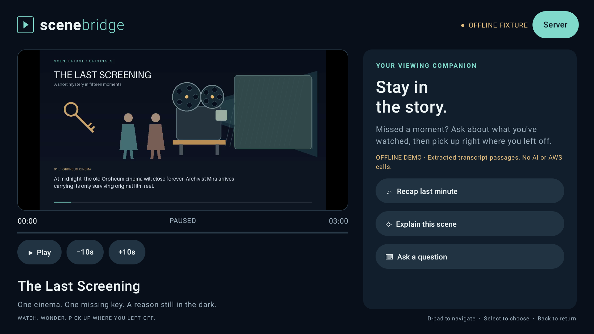

# SceneBridge

**Stay in the story.** A native Fire TV player that answers questions using completed transcript passages from before the paused playhead, with earlier-scene evidence you can replay.

**Prototype status:** the native app has been demonstrated in an Android TV emulator. The current demo uses explicitly labelled offline transcript extraction, with no language-model or AWS calls. AWS adapters are implemented, disabled by default and awaiting live verification.



The first feature is **The Last Screening**, an original three-minute narrated, illustrated mystery. Ask **“Why did Mira hide the key?”** at **01:35**, then again at **02:36**. The first answer is withheld; the second can cite the revealed explanation. Selecting evidence replays it, and returning restores the original pause.

## Run the offline demo

Prerequisites: Node 22+, Python 3.10+ with virtual environment support, and FFmpeg (including ffprobe). The following commands use a Linux/macOS shell; the automated Android tooling targets Linux x86_64.

From the repository root:

```bash
npm ci
python3 -m venv .local/render-env
. .local/render-env/bin/activate
python -m pip install -r requirements.txt
cp .env.example .env
npm run media:narrate
npm start
```

Keep the Python environment activated when regenerating media. Generated video, narration, SDK tools and build artifacts are excluded from Git; the committed story and rendering scripts recreate the offline film. The `.env` file is local configuration and is also excluded. If you already have one, keep it instead of copying over it.

Open **http://127.0.0.1:3000** for the browser development preview. The default `fixture` mode uses deterministic transcript extraction, clearly labelled **OFFLINE FIXTURE**. It does not call a language model or AWS. `npm run media:build` can generate a captioned silent edition without narration; running `media:narrate` adds offline eSpeak-NG narration.

The browser preview is a development aid. The primary deliverable is the **native Android/Fire OS TV APK**. A browser recording is not a replacement for the required TV demo.

## Build and launch the TV app

The automated setup targets **Linux x86_64** and needs a JDK 17+ (tested with 21). Other hosts require separately configured Android SDK and Gradle tooling. Keep the local backend running in another terminal.

```bash
npm run android:setup
npm run android:build
npm run android:emulator
```

In a second terminal, with the backend running:

```bash
npm run build -- --android-verify
```

The APK is written to **artifacts/SceneBridge-debug.apk**. Android tools, AVD data and Gradle caches stay under `.local/`. Setup downloads the SDK and Gradle and accepts their SDK licences. See [detailed setup](docs/SETUP.md), including physical Fire TV connections and Android Studio use.

An assembled offline source-and-demo archive can be generated with `npm run package:demo` after building the APK and capturing the walkthrough. It includes the original video, captions, source and screenshots, with no credentials or SDK caches.

That command also creates **artifacts/SceneBridge-github-source.zip**, containing only publishable source, documentation and the README screenshot. For browser uploads, extract that source ZIP and upload the contents of its `SceneBridge` folder. Put the APK, walkthrough and full demo ZIP in GitHub Releases. See [GitHub upload instructions](docs/GITHUB.md).

The app defaults to `http://10.0.2.2:3000`, the Android emulator's route to the laptop. Its **Server** button changes this address. D-pad navigation, remote selection and Android text entry are supported. Opening question entry freezes the playhead before typing. **Back** closes the answer and returns to the captured pause; **Back to the story** restores that pause and resumes playback. Progress is saved locally.

## Enable the real AWS integration

1. Configure an AWS profile locally; never put credentials in the APK or source repository.
2. Copy `.env.example` to `.env`, select your profile and region, and verify access with `npm run aws:check`.
3. Run `npm run aws:storage` to create a private bucket. Put its printed `S3_BUCKET` value in `.env`.
4. Run `npm run aws:prepare`. This generates Polly narration, renders the film, uploads it, runs Transcribe, and stores the actual timestamped transcript and captions in S3.
5. Set `SCENEBRIDGE_MODE=aws` and restart the backend. Refresh the app connection using **Server → Connect** or **Retry connection**.

In AWS mode, the backend reads its transcript from private S3, signs media URLs and invokes **Bedrock Converse** for answers. There is no silent fallback to fixtures. See [AWS architecture and operation](docs/AWS.md).

**Current verification:** offline and simulated-provider tests can run without credentials. Live AWS operation requires a configured account and model access; it must be verified before claiming an AWS Builder demo. The development target is $5, not a billing cap. Default inference is limited to 100 attempted requests per server process, 600-character questions and 600 output tokens per call. Restarting resets the counter.

## Answer boundary

```text
captured playhead → canonical transcript → exclude unfinished/future passages
    → independent Bedrock request → validate evidence IDs → bounded answer
```

- Only passages with `endMs <= positionMs` reach the provider. A partially completed sentence is withheld.
- Requests contain no previous conversation, full-story synopsis, future scene titles or global character biographies.
- Model-authored quotations and timestamps are never trusted: cited IDs resolve to eligible canonical passages.
- Invalid, missing or future citations produce an insufficient-context response. Network/model failures produce a retryable error, not a made-up answer.
- The player holds the question's original timestamp separately from evidence replay and discards stale responses after seeking or changing context.

This enforces a **context boundary**, not a mathematical guarantee that every generated sentence is supported. A model can still infer or hallucinate; live evaluation and conservative refusal remain important. The original story reduces the risk of pretrained film knowledge. This version does not inspect other streaming apps or understand visual events absent from its narration/transcript.

## Verify

Validation of this prototype: **15 backend tests, 6 browser tests, 4 Kotlin unit tests and 2 native UI tests passed**. The TypeScript check, Android build and lint also passed. Live AWS behavior remains unverified.

```bash
npm run build
npm test
npm run build -- --browser-setup
npm run test:browser
npm run android:build
npm run build -- --android-test
npm audit
```

The Android build runs Kotlin unit tests and lint. Connected UI tests need a booted emulator and the backend. Browser tests exercise the real video, byte-range seeking, before/after reveal, evidence replay, rewind, retry and narrow layouts. Screenshots and recordings belong in `artifacts/`.

See the [demo script and submission checklist](docs/DEMO.md), [product feedback](docs/PRODUCT_FEEDBACK.md), and [third-party notices](THIRD_PARTY_NOTICES.md).

## Project layout

- `android/` — Kotlin, Compose for TV and Media3 player.
- `server/` — Fastify API, context boundary, offline extraction and real AWS provider.
- `media/story.json` — original story and offline timing fixture; never used as the AWS transcription output.
- `scripts/` — rendering, offline narration, AWS preparation and local Android tooling.
- `preview/` — responsive browser development preview sharing the same API.
- `tests/` — boundary, API, ingestion and browser integration tests.

Original application code, script and generated artwork are MIT licensed. Third-party dependencies retain their own licences.
