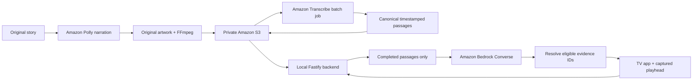

# AWS integration

## Pipeline



`aws:storage` creates one private, SSE-S3 encrypted bucket with all public-access blocking enabled. `aws:prepare` makes fifteen short Polly requests, renders the three-minute original, uploads it and starts one Transcribe job. The raw transcript remains under `scenebridge/transcribe/`; the processed sentence passages and captions become the runtime content. AWS mode does not substitute the hand-timed offline fixture for actual Transcribe output.

The server downloads `scenebridge/story.json` on startup and validates ordering, IDs and time bounds. The catalog returns one-hour signed S3 media URLs, refreshed on each catalog request. If they expire, reconnect/refresh in the TV app. Nothing needs to remain deployed continuously: the backend runs on your laptop for development and demonstration.

## Configure authentication

Use the AWS SDK default credential chain, preferably a temporary session or SSO profile. With AWS CLI installed, an existing SSO profile can be refreshed with `aws sso login --profile PROFILE_NAME`. Set `AWS_PROFILE` and `AWS_REGION` in `.env`. For access-key-based credentials, configure the profile locally using your normal AWS tools; never paste keys into chat or commit them.

In a restricted workspace, use ignored local configuration files with `AWS_SHARED_CREDENTIALS_FILE` and `AWS_CONFIG_FILE` pointing at absolute paths under `.local/aws/`. The example environment supports these variables. The CLI is not required by application code.

```bash
cp .env.example .env
# Edit profile and region locally.
npm run aws:check
npm run aws:storage
# Copy the printed bucket name into S3_BUCKET in .env.
npm run aws:prepare
# Set SCENEBRIDGE_MODE=aws.
npm run dev
```

Default region: `us-east-1`. Default inference profile: `us.amazon.nova-2-lite-v1:0`. The profile routes inference within supported US regions. Override `BEDROCK_MODEL_ID` for an account-approved Converse-capable model. The preflight verifies authentication and makes a tiny model request before media preparation.

## Required access

Provisioning needs S3 create-bucket, bucket-encryption and public-access-block permissions. Preparation needs S3 put/get, `polly:SynthesizeSpeech`, `transcribe:StartTranscriptionJob` and `transcribe:GetTranscriptionJob`. Runtime only needs S3 get-object and Bedrock invoke-model permissions for the selected inference profile and its destination foundation models. Scope S3 access to the bucket and project prefix. No credentials are embedded in the APK or browser.

Transcribe input/output buckets must be in the selected region. A failed transcription or narration slot exceeding eight seconds stops preparation; it does not publish a fabricated transcript. Inspect the named job before repeating a timeout to avoid duplicate work. Review names and timing in `media/generated/aws-story.json` before recording.

## Runtime contract

`GET /health`: backend mode and video ID. This is not proof that Bedrock was called.

`GET /catalog`: non-spoiler film metadata plus signed media/caption URLs. Never returns the transcript or full synopsis.

`POST /ask`:

```json
{"videoId":"the-last-screening","positionMs":95000,"question":"Why did Mira hide the key?"}
```

Response fields: `answer`, `citations` (canonical ID, start/end times and text), `cutoffMs`, `status` (`answered` or `insufficient_context`), `mode`. Unknown fields, out-of-range playheads and questions longer than 600 characters are rejected. Provider errors return 503; rapid repeat requests return 429. A model refusal returns a successful insufficient-context result.

Every request is independent. No later answer cache or model history can survive a rewind. Logs record eligible passage IDs, maximum evidence time, Bedrock request ID, latency and token usage without logging credentials or the whole film.

## Cost and teardown

The development target is $5; AWS pricing, retries and account configuration determine actual spend. No provisioned model capacity, vector database, API Gateway or always-on instances are created. Inference defaults to 100 attempts per process, two simultaneous requests, twelve submissions per IP per minute and 600 output tokens. These are application limits, not an AWS spending cap. Keep the server private; it has no production user authentication.

Run preparation only when you change the film. Stop the server when not testing. In the AWS console, inspect the project bucket and Transcribe jobs identified in `.local/aws-storage.json` and `media/generated/aws-preparation.json`. When judging is finished, delete those project objects, the empty bucket and finished jobs. There is no automatic deletion that could remove judging assets early.

For the AWS Builder entry, show an actual AWS-mode answer and retain its request-ID/usage log, document the four service roles, and state any unverified service honestly. An offline fixture recording alone does not demonstrate the cloud integration.
